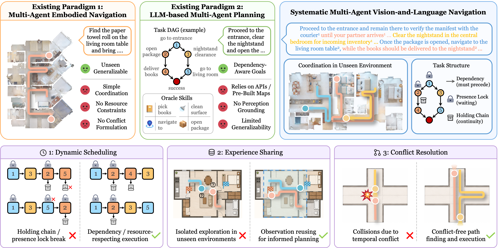

# Systematic Multi-Agent Vision-and-Language Navigation: Formulation, Benchmark, and Method

<p align="left">
  <a href="https://xyz9911.github.io/mavln/"></a>
  <a href="https://arxiv.org/abs/2609.35965"></a>
</p>

Yunzhe Xu, Zhe Liu

Shanghai Jiao Tong University



## News

- The code, the MAVLN benchmark, and model checkpoints will be released in this repository.

## Overview

Vision-and-Language Navigation (VLN) has largely focused on a single agent following a single instruction, yet many real-world applications require teams of robots to tackle tasks beyond the capabilities of any individual agent. We present **Systematic Multi-Agent Vision-and-Language Navigation**, the first systematic formalization of multi-agent VLN as a constrained coordination problem: each mission consists of subtasks carrying dependency and resource constraints (presence locks and holding chains).

- **MAVLN** is a benchmark built with a verified four-stage crafting pipeline. It contains 11,724 episodes across 145 HM3D scenes, with teams of up to four agents under three instruction regimes, and comes with constraint-aware metrics.
- **TRISS** is a coordination-ready navigation system. It couples an LLM-based subtask scheduler, a shared topological memory that turns each agent's exploration into team knowledge, and a conflict-aware execution mechanism that realizes simultaneous intentions as collision-free routes.

Extensive experiments establish TRISS as a comprehensive baseline and reveal substantial room for improvement across scheduling, navigation, and execution.

## The MAVLN Benchmark

Each mission is a directed acyclic graph over subtasks. Beyond dependencies, two resource primitives restrict what an agent may do: under a *holding chain*, the agent carries an object and may complete nothing else until it delivers it; under a *presence lock*, the agent must stay at its goal until a teammate releases it. A mission succeeds only if every subtask succeeds under these constraints.

| | |
|:--|--:|
| Episodes | 11,724 |
| Unique missions | 3,908 |
| Scenes (HM3D) | 145 |
| Average path length | 35.9 m |
| Agents per team | up to 4 |
| Subtasks per episode | 5 on average, up to 8 |

Every mission is rendered in three instruction regimes: **decentralized** (one instruction per agent), **centralized** (one instruction for the whole team), and **centralized-implicit** (one team instruction without agent attribution). Missions are split scene-disjointly:

| Split | Missions | Scenes |
|:--|--:|--:|
| Train | 3,079 | 128 |
| Val-unseen | 386 | 7 |
| Test-unseen | 443 | 10 |

## TRISS

- **LLM-based subtask scheduler.** Extracts a pool of atomic navigation instructions from the task instructions and dispatches at most one per agent in each round, reasoning about the constraints stated in language.
- **Shared topological memory.** All agents build one topological map on the fly; a DUET-style cross-modal planner reasons over it with each agent's own instruction.
- **Conflict-aware execution.** Conflict-free target allocation and conflict-based search produce collision-free routes, while topology maintenance keeps failed or drifting executions from corrupting the shared map.

## Results

Test-unseen results. LLM results are means over three runs; see the paper for val-unseen and the full set of metrics.

| Scheduler | Navigator | SR ↑ | SPL ↑ | CSR ↑ | CSPL ↑ | TC ↑ | MAC ↓ |
|:--|:--|--:|--:|--:|--:|--:|--:|
| Oracle | ETPNav | 5.6 | 4.2 | 28.7 | 22.4 | 100.0 | 0.85 |
| Oracle | TRISS | 9.3 | 5.2 | 33.3 | 20.0 | 100.0 | 1.42 |
| Gemma4 · decentralized | TRISS | 8.3 | 4.4 | 33.2 | 19.5 | 95.8 | 1.22 |
| Qwen3.6 · decentralized | TRISS | 7.9 | 4.1 | 32.1 | 18.7 | 97.4 | 1.26 |
| Gemma4 · centralized | TRISS | 6.8 | 3.9 | 31.6 | 18.6 | 95.0 | 1.13 |
| Qwen3.6 · centralized | TRISS | 8.4 | 4.2 | 32.4 | 19.1 | 96.5 | 1.03 |
| Gemma4 · centralized-implicit | TRISS | 7.1 | 3.7 | 29.6 | 17.0 | 92.8 | 0.97 |
| Qwen3.6 · centralized-implicit | TRISS | 6.8 | 3.5 | 28.8 | 16.5 | 96.5 | 1.03 |

SR: mission success rate. SPL: SR weighted by path length. CSR: conditional subtask success rate, honoring all dependency and resource constraints. CSPL: its path-length-weighted counterpart. TC: task completion. MAC: multi-agent conflict.

## Acknowledgements

Our implementation builds on [Habitat 3](https://github.com/facebookresearch/habitat-lab), and uses the [HM3D](https://aihabitat.org/datasets/hm3d/) scene dataset. We thank the authors for their open-source contributions.

## Citation

If you find this work useful, please cite:

```bibtex
@article{xu2026mavln,
    title={Systematic Multi-Agent Vision-and-Language Navigation: Formulation, Benchmark, and Method},
    author={Xu, Yunzhe and Liu, Zhe},
    journal={arXiv preprint arXiv:2609.35965},
    year={2026}}
```
